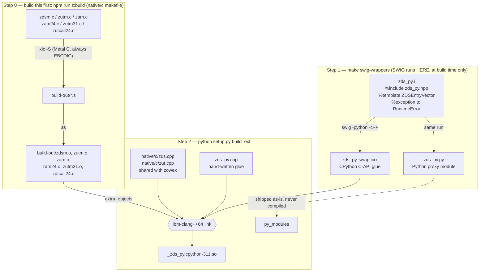
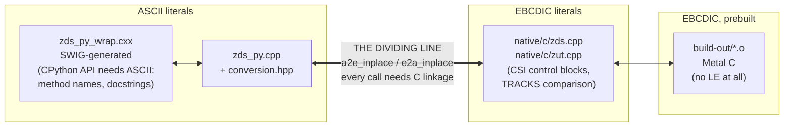
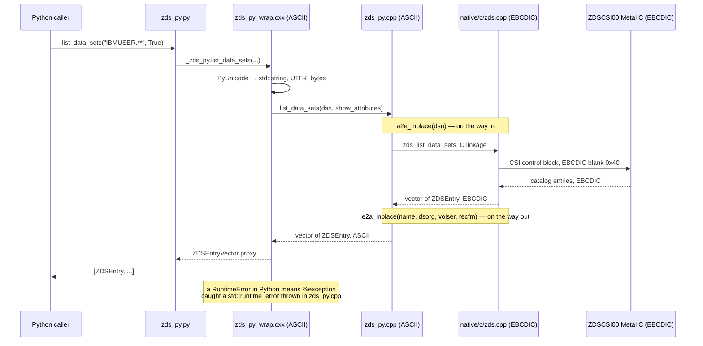
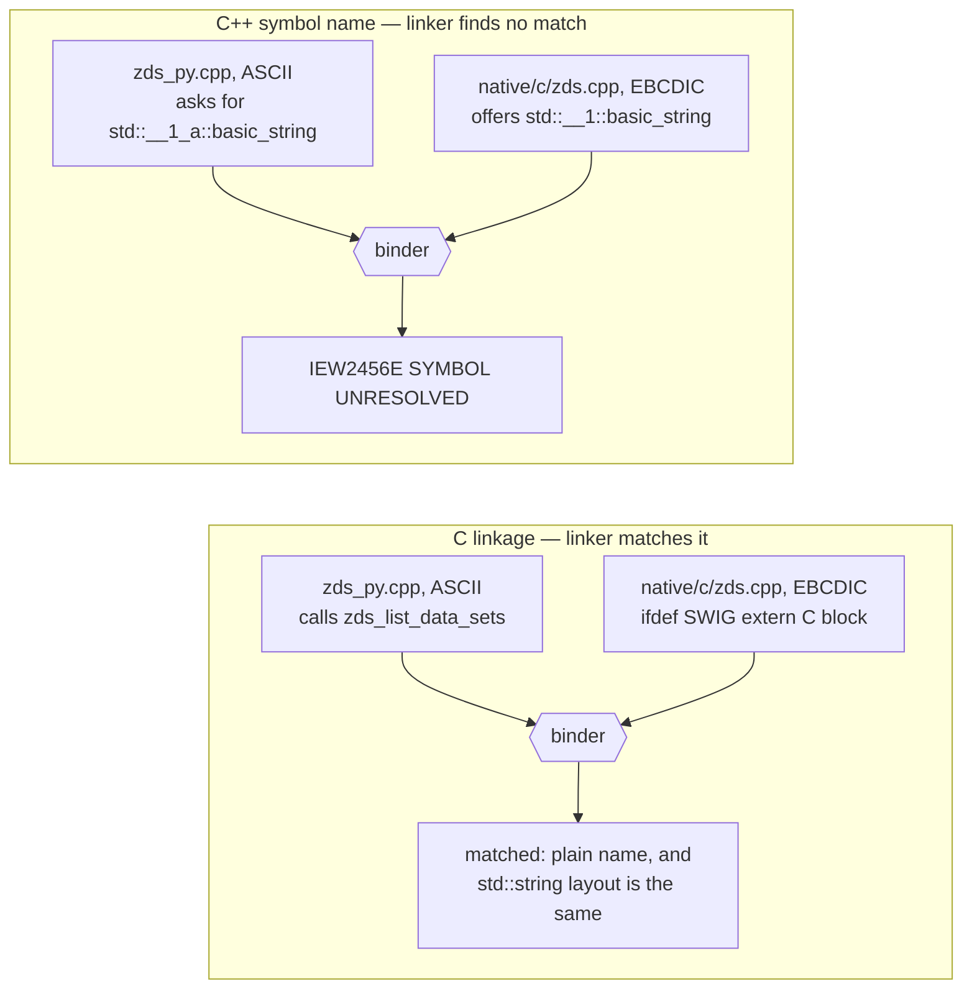

# Zowe Remote SSH Python Bindings Distributions

This directory contains utility scripts to bundle and distribute the Python bindings for the Zowe Remote SSH (ZRS) project on z/OS. 

The wheel and precompiled bundle do not require SWIG on the installation target.
Native binaries depend on compatible z/OS and Python runtimes; the source bundle
can be rebuilt for a different target.

## Python wheel

`make wheel` builds a pip-installable wheel using IBM Python 3.11. The npm build
includes native copies for IBM Python 3.11, 3.13, and 3.14; the loader selects the
copy matching the active interpreter. Imports are `zds_py`, `zjb_py`, `zusf_py`,
`zkr_py`, and `zsys_py`.

The Python distribution is named `zo`. Its version comes from the root
`package.json`, the same release version used by the native `zo` binary, so
`npm run version:bump` also updates subsequent Python builds. The default filename
is currently `zo-1.0.2-py3-none-any.whl`. The `py3-none-any` tag works around
pip's differing `os390`/`zos` platform tags. The archive contains native z/OS
binaries, and imports require a bundled, GIL-enabled IBM CPython runtime on z/OS.

The wrappers use Python's Limited API, but the z/OS binder records the Python DLL
name in each extension. Supporting another minor Python version requires adding
its side deck and runtime selection to the build, then running the installed-wheel
tests with that interpreter. The Limited API alone does not make these binaries
compatible with future Python versions.

### Install in a fresh z/OS venv

Select a supported IBM Python interpreter, then run:

```sh
python -m venv my-venv
my-venv/bin/python -m pip install --no-index /path/to/zo-1.0.2-py3-none-any.whl
my-venv/bin/python -c 'import zds_py, zjb_py, zusf_py, zkr_py, zsys_py'
```

Installation needs no compiler, SWIG, source checkout, or `PYTHONPATH`. The system
must provide compatible Language Environment/C++ runtimes and System SSL. Transfer
the wheel without text conversion and verify its checksum before installing it.

When reusing an environment with the former `zbind` distribution, run
`python -m pip uninstall zbind` before installing `zo`, since both distributions
provide the same binding modules.

### Build on z/OS

From the project root on your laptop, run:

```sh
npm run z:python:wheel
```

This command stages the current native and binding sources in a temporary
directory on the configured z/OS host, builds the wheel and native prerequisites,
then downloads the wheel and its SHA-256 file to the **project root
`dist/`**. It verifies the download and removes its temporary local and remote
directories, including the build venv. Existing remote sources remain available.
Generated native headers must already exist in the remote deployment's `c/chdsect`.

The command is implemented in `scripts/buildTools.ts` and uses the active
`config.yaml` profile's `sshProfile`, `deployDir`, and `preBuildCmd`, including
`--profile=<name>` selection. It invokes `package_wheel.py --build-from-stdin`
for runtime discovery, build-venv setup, dependency installation, and the normal
`make wheel` target. Configure Python locations under that profile:

```yaml
pythonEnv:
  ZPY_PYTHON_ROOT: /usr/lpp/IBM/cyp/
  # ZPY_PYTHON_311: /path/to/python3.11
  # ZPY_PYTHON_313: /path/to/python3.13
  # ZPY_PYTHON_314: /path/to/python3.14
```

`ZPY_PYTHON_ROOT` defaults to `/usr/lpp/IBM/cyp/`, with interpreters at
`v3r11/pyz/bin/python`, `v3r13/pyz/bin/python`, and `v3r14/pyz/bin/python`.
Use `~/python` for a home-directory installation, or override individual
executables with the settings above. Local `ZPY_*` environment variables override
`pythonEnv`. SSH target and deployment root come from the selected profile.
The command uses the runtimes directly and does not change `fpm`.
If `PIP_INDEX_URL` is set locally, it is passed through SSH input to pip without
putting its credentials in command arguments; otherwise the remote profile's
index is used.

### Build manually on z/OS

Use a dedicated IBM Python 3.11 build venv and install `requirements-build.txt`.
Uploaded EBCDIC requirements files must first be converted to UTF-8 for pip:

```sh
build_python=$(python -c 'import os, sys; print(os.path.realpath(sys.executable))')
"$build_python" -m venv wheel-build-venv
iconv -f IBM-1047 -t UTF-8 requirements-build.txt > requirements-build-utf8.txt
chtag -t -c UTF-8 requirements-build-utf8.txt
wheel-build-venv/bin/python -m pip install -r requirements-build-utf8.txt
make wheel PYTHON=wheel-build-venv/bin/python \
  WHEEL_ARGS="--runtime cp313=/path/to/libpython3.13.x --runtime cp314=/path/to/libpython3.14.x"
```

Replace the side-deck paths with those from the installed IBM runtimes. The default
`any` platform tag avoids platform matching in pip; `--platform` remains available
for an explicit override. Without additional `--runtime` arguments, the wheel
contains only Python 3.11. For deployments without the repository root, pass
`--license-file /path/to/LICENSE` in `WHEEL_ARGS`.
The build also needs the release `package.json` at the repository root or beside
the deployed `c/` and `python/` directories; the npm wheel command stages it
automatically.

The target builds native prerequisites and SWIG wrappers, stages UTF-8 proxies,
links the specified runtime variants, and writes the wheel to the bindings'
`dist/`. The npm command downloads it to the project's root `dist/`. The existing
`make build` workflow remains available.

### Verify the installed wheel

For each target interpreter, the runner creates a fresh venv and stages a separate
copy of the tests. Set `TMPDIR` to an existing
directory with sufficient space if the default `/tmp` filesystem is small:

```sh
python test/run_wheel_tests.py /path/to/zo-1.0.2-py3-none-any.whl
python test/run_wheel_tests.py /path/to/zo-1.0.2-py3-none-any.whl --system
python test/run_wheel_tests.py /path/to/zo-1.0.2-py3-none-any.whl --functional --owner YOURID
```

The first command tests installation, wheel metadata, native module selection,
UTF-8 USS reads, system input validation, and SWIG lifetimes. The second adds
read-only system integration tests. The third also creates disposable dataset,
USS, job, and certificate/key-ring resources under the specified user. Tests use
the configured `PIP_INDEX_URL` to obtain pytest/PyYAML; keep credentials in the environment.
Logs and JUnit reports remain in the reported validation directory. Successful
runs check uninstall/reinstall, then remove the venv unless `--keep-venv` is set.

`npm run z:python:wheel -- --test` validates installation and read-only system calls
on all three selected runtimes before downloading the wheel. It runs sequentially
and places temporary environments in its build staging directory. The Python CI workflow
runs this matrix when the repository variable `ZRS_PYTHON_WHEEL_MATRIX` is `true`;
`ZRS_PYTHON_ROOT` can select the provisioned runtime directory. Source-based tests,
including the isolated system adapter fixture, run in the ordinary Python CI job.

### Post development artifacts to a PR

After building a wheel and/or running `npm run z:python:pack`, run:

```sh
npm run z:python:post -- <PR_NUMBER>
```

The command uploads the available tarball and `zo` wheel from root `dist/`
to the `py-bindings-dev` prerelease and creates or updates the PR comment with
download links. It uses the current Git commit for the artifact build tag, for
example `zo-1.0.2-1pr1181gabcdef12-py3-none-any.whl`, and generates a matching
SHA-256 file. It does not rebuild or test the artifacts.

Posting requires an authenticated GitHub CLI (`gh`). Keep only the wheel you
intend to post in `dist/`; multiple wheels cause an error. Move
`zbind_bin_dist.tar.gz` out of `dist/` to omit the tarball from the upload.

## Available Functions

The bindings are split across five modules, each generated from the corresponding `*_py.hpp` header. All functions raise a Python exception on failure instead of returning an error code. The `zds_py`, `zjb_py`, and `zusf_py` modules use `RuntimeError`; see the `zkr_py` and `zsys_py` sections below for structured exceptions.

### `zds_py` — Data Sets

| Function | Description |
| --- | --- |
| `create_data_set(dsn: str, attributes: DS_ATTRIBUTES)` | Create a new dataset with the specified attributes. |
| `list_data_sets(dsn: str, show_attributes: bool = False) -> list[ZDSEntry]` | List datasets matching the given pattern. Pass `show_attributes=True` to populate `dsorg`, `volser`, `recfm` and `migrated`. |
| `read_data_set(dsn: str, codepage: str = "") -> str` | Read content from a dataset with optional encoding. |
| `write_data_set(dsn: str, data: str, codepage: str = "", etag: str = "") -> str` | Write data to a dataset with optional encoding and etag validation. |
| `delete_data_set(dsn: str)` | Delete the specified dataset. |
| `create_member(dsn: str)` | Create a new member in a partitioned dataset. |
| `list_members(dsn: str) -> list[ZDSMem]` | List all members in a partitioned dataset. |

**Supporting types:**

- `DS_ATTRIBUTES`: `alcunit`, `blksize`, `dirblk`, `dsorg`, `primary`, `recfm`, `lrecl`, `dataclass`, `unit`, `dsntype`, `mgntclass`, `dsname`, `avgblk`, `secondary`, `size`, `storclass`, `vol`
- `ZDSEntry`: `name`, `dsorg`, `volser`, `recfm`, `migrated` (all but `name` require `show_attributes=True`)
- `ZDSMem`: `name`

### `zjb_py` — Jobs

| Function | Description |
| --- | --- |
| `list_jobs_by_owner(owner_name: str) -> list[ZJob]` | List all jobs owned by the specified user. |
| `list_jobs_by_owner(owner_name: str, prefix: str, status: str) -> list[ZJob]` | List jobs owned by the specified user, filtered by job name prefix and status. |
| `get_job_status(jobid: str) -> ZJob` | Get the current status of a job by job ID. |
| `list_spool_files(jobid: str) -> list[ZJobDD]` | List all spool files (DD statements) for a job. |
| `read_spool_file(jobid: str, key: int) -> str` | Read the content of a specific spool file by job ID and key. |
| `get_job_jcl(jobid: str) -> str` | Retrieve the JCL content for a job. |
| `submit_job(jcl_content: str) -> str` | Submit JCL content and return the assigned job ID. |
| `delete_job(jobid: str) -> bool` | Delete a job from the system and return success status. |

**Supporting types:**

- `ZJob`: `jobname`, `jobid`, `owner`, `status`, `full_status`, `retcode`, `correlator`
- `ZJobDD`: `jobid`, `ddn`, `dsn`, `stepname`, `procstep`, `key`

### `zusf_py` — USS (Unix System Services)

| Function | Description |
| --- | --- |
| `create_uss_file(file: str, mode: str)` | Create a new USS file with the specified permissions. |
| `create_uss_dir(file: str, mode: str)` | Create a new USS directory with the specified permissions. |
| `list_uss_dir(path: str, options: ListOptions = ListOptions(False, False)) -> str` | List contents of a USS directory. |
| `move_uss_file_or_dir(source: str, destination: str)` | Move a USS file or directory. |
| `read_uss_file(file: str, codepage: str = "") -> str` | Read content from a USS file with optional encoding. |
| `read_uss_file_streamed(file: str, pipe: str, codepage: str = "", content_len: size_t* = None)` | Read USS file content to a pipe in streaming mode. |
| `write_uss_file(file: str, data: str, codepage: str = "", etag: str = "") -> str` | Write data to a USS file with optional encoding and etag validation. |
| `write_uss_file_streamed(file: str, pipe: str, codepage: str = "", etag: str = "", content_len: size_t* = None) -> str` | Write data from a pipe to a USS file in streaming mode. |
| `chmod_uss_item(file: str, mode: str, recursive: bool = False)` | Change permissions of a USS file or directory. |
| `delete_uss_item(file: str, recursive: bool = False)` | Delete a USS file or directory, with optional recursion. |
| `chown_uss_item(file: str, owner: str, recursive: bool = False)` | Change ownership of a USS file or directory. |
| `chtag_uss_item(file: str, tag: str, recursive: bool = False)` | Change the file tag of a USS file or directory. |

**Supporting types:**

- `ListOptions(all_files: bool = False, long_format: bool = False, max_depth: int = 1)`

### `zsys_py` — System information and SYSLOG

Together with `zkr_py`, this module covers all 21 canonical commands under `zo system`.
Calls execute locally on z/OS under the Python process's identity and retain the GIL.

| Function | Result |
| --- | --- |
| `display_symbol(symbol)` | Symbol value as `str`; pass a bare name such as `SYSNAME`. |
| `list_parmlib()` | Sequence of dataset names in native search order. |
| `list_proclib()` | Sequence of JES PROCLIB dataset names. |
| `list_subsystems(filter="*")` | Sequence of subsystem names using the native matching rules. |
| `list_apf()` | Sequence of `ApfEntry` objects with `dsname` and `volume` fields. |
| `list_linklist()` | Sequence of `LinklistEntry` objects with `dsname`, `volume`, and `apf` fields. |
| `view_syslog(*, date=None, time=None, seconds_ago=None, max_lines=None)` | `SyslogResult`. |

Listing results preserve order and duplicates. They support iteration, indexing, and
`len()`; use `list(result)` when a built-in list is needed. Entries retained after the
result variable is deleted keep their storage alive. Avoid mutating a result vector
while retaining its elements. Dataset names, volumes, and subsystem names lose only
fixed-field trailing blanks. Symbol values and SYSLOG record text retain their content.
All returned text is converted from IBM-1047 to UTF-8, including embedded NULs in records.

Symbol names are uppercased and prefixed with `&` internally. Names must contain
1–126 ASCII letters, digits, or `@`, `#`, `$`, `_`. Subsystem filters accept the same
characters plus `*`, with a maximum of four characters. Unresolved symbols retain
the native service's result or error behavior.

SYSLOG options use the z/OS system offset used by the native reader, independently
of Python's process `TZ` setting. The existing CLI keeps its process-time behavior.

| Options | Resolved start | Default line limit |
| --- | --- | --- |
| None | Current time minus 30 seconds | 10,000 |
| `seconds_ago=N` | Current time minus N seconds | 10,000 |
| `date` and `time` | Both supplied values | 100 |
| Only `date` | Supplied date and current time | 100 |
| Only `time` | Current date and supplied time | 100 |

`seconds_ago` accepts integers 1–86,400 and excludes `date` and `time`.
`max_lines` accepts integers 1–10,000. Booleans are not counts. `None` means omitted;
empty strings and zero are invalid. Dates must be real calendar dates in `YYYY-MM-DD`
within 1900–2185; times must use `HH:MM:SS` without fractional seconds or trailing text.

`SyslogResult` owns `data`, `start_date`, `start_time`, `end_date`, `end_time`,
`returned_lines`, and `has_more`. Empty reads have empty data/end fields and zero lines.
`has_more` means the native reader reached the limit; it does not prove another record
exists. End timestamps have second precision. They cannot support lossless pagination,
so this API does not automatically continue a read.
Native SYSLOG positioning determines which records are available; a future start
does not guarantee an empty result. Native services can also reject dates accepted
by the argument validator (for example, an unsupported CONVTOD date).

Invalid types raise `TypeError`, invalid values raise `ValueError`, and native failures
raise `ZsysError`, a `RuntimeError` subclass. It exposes `operation`, `rc`, `service_name`,
`detail_rc`, `service_rc`, `service_rsn`, and `service_rsn_secondary`. Unavailable native
fields remain empty or zero. A failed read raises instead of returning partial data as
success.

```python
import zsys_py as system

print(system.display_symbol("sysname"))
for entry in system.list_linklist():
    print(entry.dsname, entry.volume, entry.apf)

try:
    result = system.view_syslog(seconds_ago=300, max_lines=250)
    print(result.data, end="")
    print(result.start_date, result.start_time, result.returned_lines)
except system.ZsysError as error:
    print(error.operation, error.service_name, error.rc, str(error))
```

The native `zsys.cpp` owns PROCLIB/SYSLOG operations and shared CLI option resolution.
`zspool.cpp` owns the allocation protocol shared with job spool reads. Existing
`zjb_list_proclib`, `zjb_read_syslog`, and their legacy types remain available as
compatibility entry points. CLI parsing remains unchanged; Python applies its stricter
validation before shared resolution. Certificate and key-ring APIs remain in `zkr_py`.

Build only this module with `make build-zsys`. Run `make setup test-zsys` in `test/`
with the extension build directory on `PYTHONPATH`. `test_zsys.py` exercises contracts
without system authority; `test_zsys_integration.py` calls read-only system services.
After generating the SWIG wrappers, run `make setup test-zsys-fixture` in `test/`
to exercise conversion, errors, and ownership with isolated native service substitutes.
Set `ZSYS_TEST_ZO` to the freshly built executable for CLI parity checks. Installed-wheel
validation runs the contract suite by default; add `--system` to
`test/run_wheel_tests.py` for system integration tests on each bundled runtime.

### `zkr_py` — Certificates and key rings

| Function | Description |
| --- | --- |
| `create_keyring(owner: str, keyring: str) -> str` | Create a new key ring (R_datalib NEWRING). Returns a non-fatal SAF warning, or `""`. |
| `delete_keyring(owner: str, keyring: str) -> str` | Delete a key ring (R_datalib DELRING). |
| `list_rings(owner: str, keyring: str = "") -> ZkrRingList` | Enumerate a user's key rings and the certificates connected to each. `keyring=""` (or `"*"`) returns all of the owner's rings. |
| `count_ring(owner: str, keyring: str) -> int` | Count the certificates connected to a key ring, or the owner's whole virtual key ring (`keyring="*"`). |
| `refresh_digtcert() -> str` | Refresh the DIGTCERT class (R_datalib REFRESH). |
| `list_certificates(owner: str, keyring: str, label: str = "", usage: str = "", max_entries: int = 10) -> ZkrCertList` | List the certificates connected to a key ring, with RACDCERT LABEL-style exact filtering. |
| `show_certificate(owner: str, keyring: str, label: str) -> ZKRCertDetail` | Retrieve detailed information (subject, serial number, validity) for a single certificate. |
| `set_default_certificate(owner: str, keyring: str, label: str) -> str` | Make a certificate the default certificate of a key ring. |
| `connect_certificate(owner: str, keyring: str, label: str, from_ring: str = "", from_database: bool = False, usage: str = "", make_default: bool = False) -> str` | Connect a certificate that already exists in the ESM database to a key ring. |
| `delete_certificate(owner: str, keyring: str, label: str, database: bool = False, skip_refresh: bool = False) -> str` | Remove/disconnect a certificate from a key ring or the ESM database (`database=True`). |
| `trust_certificate(owner: str, label: str, status: str) -> str` | Change a certificate's trust status (`TRUST`, `HIGHTRUST`, or `NOTRUST`). |
| `rename_certificate(owner: str, label: str, new_label: str) -> str` | Rename a certificate's label. |
| `export_certificate(owner: str, keyring: str, label: str, format: str = "pem", password: str = "") -> bytes` | Export a certificate as bytes: PEM text (ISO8859-1) by default, or a PKCS#12 bundle (`format='p12'`, password required). |
| `export_certificate_to_file(owner: str, keyring: str, label: str, file: str, format: str = "pem", password: str = "") -> int` | Export a certificate to a private (0600) file; returns the number of bytes written. |
| `export_certificate_to_dsn(owner: str, keyring: str, label: str, dsn: str, format: str = "pem", password: str = "") -> int` | Export a certificate to a sequential data set or PDS/E member; returns the number of bytes written. |
| `import_certificate(owner: str, keyring: str, label: str, usage: str, password: str, data: bytes, skip_refresh: bool = False) -> str` | Import a certificate (and private key, when present) from PKCS#12 `bytes` into a key ring. |
| `import_certificate_from_file(owner: str, keyring: str, label: str, usage: str, password: str, file: str, skip_refresh: bool = False) -> str` | Import a certificate from a PKCS#12 file into a key ring. |
| `import_certificate_from_dsn(owner: str, keyring: str, label: str, usage: str, password: str, dsn: str, skip_refresh: bool = False) -> str` | Import a certificate from a PKCS#12 data set or PDS/E member into a key ring. |

**Supporting types:**

- `ZKRCertInfo`: `label`, `owner`, `usage`, `status`, `is_default`
- `ZKRCertDetail`: adds `subject`, `record_id`, `key_type`, `key_size`, `serial_number`, `not_before`, `not_after`, `has_validity`
- `ZKRRingCert`: `owner`, `label`
- `ZKRRingEntry`: `owner`, `name`, `certs: list[ZKRRingCert]`
- `ZkrCertList`: `items: list[ZKRCertInfo]`, `more_available`
- `ZkrRingList`: `items: list[ZKRRingEntry]`, `warning`
- `ZkrError(RuntimeError)`: raised for failures reported by the native certificate/key ring service layer, with `service`, `function_code`, `saf_rc`, `esm_rc`, `esm_rsn`, `gsk_rc` attributes carrying the same structured SAF/ESM/GSK codes the RPC layer exposes programmatically.

Invalid arguments raise `ValueError`. All three export functions accept only the
case-sensitive formats `"pem"` and `"p12"`; other values raise `ValueError` before
exporting. File writes in `export_certificate_to_file`, data set writes in
`export_certificate_to_dsn`, and data set reads in `import_certificate_from_dsn`
raise plain `RuntimeError` on I/O failure. File reads in `import_certificate_from_file`
are handled by the native service layer and raise `ZkrError`. Catch `RuntimeError`
to handle both plain I/O failures and `ZkrError`, or catch `ZkrError` separately
when its structured diagnostics are needed.

`zkr_py` and `zsys_py` enable named arguments with SWIG's `%feature("kwargs")`,
for example `export_certificate(owner, ring, label, format="p12", password=...)`
and `list_subsystems(filter="JES*")`. The Python `view_syslog` wrapper requires
keyword arguments. The dataset, job, and USS modules use positional arguments.

## Architecture

Each module is a CPython extension. Building one runs SWIG plus two different IBM compilers, and the
finished extension has to hand strings back and forth between code that stores text as ASCII and code
that stores it as EBCDIC. This section shows where that dividing line sits, because putting it in the
wrong place corrupts your data instead of breaking the build.

### The build pipeline

`npm run z:python:build` runs `make` in this directory, and its default target is
`all: swig-extenders build`. Build the native code first with `npm run z:build` — the Metal C object
files come from the `native/c` makefile, not from this one.



**SWIG only ever runs on the build machine.** It reads the `.i` files and writes two things:
`*_py_wrap.cxx`, which gets compiled into the `.so`, and `*_py.py`, which ships exactly as generated —
that second file is the module you `import`. That is why neither distribution below needs SWIG on the
target machine. The source bundle ships the generated `.cxx` and only has to recompile it, and the
precompiled bundle ships the finished `.so` next to the `*_py.py`.

`zkr_py` follows the same two steps above, with one difference in Step 2's link: it adds
`/usr/lib/GSKCMS64.x`, the System SSL side deck `native/c/zkr.cpp` calls into (`gsk_export_key` /
`gsk_import_key`), to `extra_objects`. It has no Metal C object of its own — `zkr_py`'s
`extra_objects` list is the same `zdsm.o` / `zutm.o` / `zam.o` / `zam24.o` / `zutm31.o` /
`zutcall24.o` set `zds_py` and `zjb_py` already need for the `native/c/zds.cpp` it shares with them,
plus that one side deck.

`zsys_py` links `zsys.cpp`, `zspool.cpp`, `zds.cpp`, and `zut.cpp`, plus the
six shared Metal objects shown above and `zjbm.o` for JES PROCLIB queries.
`zjb_py` also links `zsys.cpp` and `zspool.cpp` for its compatibility entry points
and spool reads. Each extension has its own `SWIG_TYPE_TABLE`.

### Where the ASCII/EBCDIC line falls

The `-fzos-le-char-mode` flag tells `ibm-clang++64` which encoding to store string literals in. Left
alone the compiler picks EBCDIC, but Python's own build flags (from `sysconfig`) add
`-fzos-le-char-mode=ascii`, so every file compiled through `setup.py` gets ASCII instead. The flag
applies to one source file at a time, which lets `setup.py` choose per file:



| box | where its encoding comes from |
| --- | --- |
| ASCII literals | Python's `sysconfig` build flags: `-fzos-le-char-mode=ascii` |
| EBCDIC literals | added back by `BuildExtMixedCharMode` in `setup.py`: `-fzos-le-char-mode=ebcdic` |
| EBCDIC, prebuilt | `xlc` Metal C — always EBCDIC, no flag involved |

The files under `native/c` have to stay EBCDIC. They build control blocks a byte at a time and count on
their literals already being EBCDIC: the CSI filter key in `zds_list_data_sets`, for instance, is padded
with `' '` and that blank has to be `0x40`. They also call Metal C routines, which run with no Language
Environment and know nothing about ASCII. Compiling these files as ASCII still builds cleanly — it just
quietly changes what every literal means.

### A call crossing the line



### Why calls across the line need `extern "C"`

IBM's libc++ gives each encoding mode its own namespace name, so an ASCII `std::string` and an EBCDIC
`std::string` end up with different symbol names in the object files. As far as the linker is concerned
they are two unrelated types. So anything the bindings call has to be declared inside an
`#ifdef SWIG extern "C"` block in the shared header — `native/c/zds.hpp`, `native/c/zjb.hpp`,
`native/c/zusf.hpp` and `native/c/zkr.hpp` each have one. Miss a declaration and the bind step fails
with `IEW2456E`:



Only the name differs; the two `std::string` types have identical memory layout. So once the linker can
find the symbol, passing a `std::string` or a `std::vector` across the line is safe. C linkage does come
with two limits:

- **It cannot handle overloads,** since every C name has to be unique. `zjb_list_by_owner` has three
  overloads, so only the owner/prefix/status one is declared for SWIG; the two convenience forms sit
  behind `#ifndef SWIG`.
- **It cannot return a C++ type.** 
  - `zusf_format_file_entry` returns a `std::string`
  - `zkr_filter_certs` returns a `std::vector<ZKRCertInfo>` by value. 
    - The workaround is `zkr_filter_certs_into` which appends to a caller-supplied `std::vector &`.

### Which strings get converted

**Convert text in the binding only when the shared layer does not.** The modules
handle file content differently; `zsys_py` also converts its native text to UTF-8.

| what crosses | `zds_py` / `zjb_py` | `zusf_py` | `zkr_py` | `zsys_py` |
| --- | --- | --- | --- | --- |
| identifiers going in (DSN, path, jobid, owner, prefix, tag, symbol, filter) | `a2e` | `a2e` | `a2e` | `a2e` |
| codepage name, etag going in | `a2e` | `a2e` | n/a | n/a |
| etag coming back | `e2a` | `e2a` | n/a | n/a |
| diagnostics, listing text, and result fields | `e2a` | `e2a` | `e2a` | IBM-1047 to UTF-8 |
| file or data set **content** | `a2e` / `e2a` for the default codepage; none for an explicit codepage | none | see below | n/a |
| SYSLOG date/time going in | n/a | n/a | n/a | `a2e` |
| symbol values, SYSLOG records, and date/time coming back | n/a | n/a | n/a | IBM-1047 to UTF-8 |

`zusf` converts content in both directions on its own: it checks the requested codepage and the file
tag together, so leaving the content untouched is what makes it round-trip whether the file is tagged or
not. Data sets have no tag, so `zds` converts only when you pass an explicit codepage. The
binding converts default-codepage content itself and leaves explicitly encoded content for
`zds` to convert. Incoming etags and codepage names are converted to EBCDIC in both cases.

Each extension uses a distinct `SWIG_TYPE_TABLE` so loading all five modules does not route
an iterator through another DLL's proxy. Certificate result vectors retain their parent
object, allowing expressions such as `list_certificates(...).items` without dangling storage.

`zsys_py` converts ASCII identifiers to IBM-1047 on input. Its symbol values, list
fields, SYSLOG records, and diagnostics use a length-aware IBM-1047 to UTF-8 converter
on output; the older modules' Latin-1 `e2a` helpers are unchanged.

**`zkr_py`'s `bytes` payloads: the one boundary with no conversion in either direction.** `export_certificate`,
`export_certificate_to_file`/`_to_dsn`, and `import_certificate`/`_from_file`/`_from_dsn` all take or
return PKCS#12 as Python `bytes` (typedef'd `ZkrBytes`, typemapped to `PyBytes_FromStringAndSize` /
`PyBytes_AsStringAndSize` in `zkr_py.i` — `std_string.i`'s default `str` typemap would corrupt it, since
PKCS#12 DER is not valid UTF-8). Those bytes are never run through `a2e`/`e2a`: RACDCERT's own
`FORMAT(PKCS12DER)` output is binary, not text in either encoding, so converting it would corrupt it in
both directions.

PEM is different — it *is* text, and gets `e2a`'d for `export_certificate`'s return value (so the
`bytes` you get back are portable ISO8859-1, decodable as ASCII) but deliberately **not** for
`export_certificate_to_file`/`_to_dsn`: PEM written to a file or data set stays EBCDIC, byte-identical
to what `RACDCERT EXPORT`/keyring-util already produce there. Converting on-disk PEM to ASCII would
silently break that parity, so `native/python/bindings/test/test_zkr.py`'s
`test_pem_export_to_file_stays_ebcdic_and_private` asserts the on-disk bytes do **not** start with the
ASCII `-----BEGIN CERTIFICATE-----` banner, specifically so nobody "fixes" this later.

## Distribution Types

### 1. Precompiled Binary Distribution (`zbind_bin_dist.tar.gz`)
*Designed for end-users who just want to use the Python bindings immediately without compiling anything.*

- **Compiled on:** The build mainframe (e.g. `lpar.1`).
- **Dependencies needed on target:** Only Python (e.g. Python 3.11, 3.12, etc.) and System SSL
  (`/usr/lib/GSKCMS64.x`, which `zkr_py`'s `_zkr_py.so` links against — present on z/OS by default).
  **No compiler, SWIG, C++ sources, or headers are required.**
- **How to Build:**
  ```bash
  python package_precompiled.py
  ```
  This creates `zbind_bin_dist.tar.gz` containing precompiled shared libraries (`_*.so`), wrapper modules (`*.py`), and package metadata.

- **How to Extract & Use on Target Machine (e.g. `lpar.2`):**
  1. Transfer `zbind_bin_dist.tar.gz` to the target machine (binary mode).
  2. Unpack the tarball safely (disabling C-runtime autoconversion):
     ```bash
     chtag -b zbind_bin_dist.tar.gz
     python3 -c "import gzip; f_in = gzip.open('zbind_bin_dist.tar.gz', 'rb'); f_out = open('zbind_bin_dist.tar', 'wb'); f_out.writelines(f_in); f_in.close(); f_out.close()"
     chtag -b zbind_bin_dist.tar
     tar -xf zbind_bin_dist.tar && rm zbind_bin_dist.tar
     ```
  3. Untag the files inside the extracted folder:
     ```bash
     chtag -r zbind_bin_dist/*
     ```
  4. Import instantly in your scripts using `sys.path`:
     ```python
     import sys
     sys.path.insert(0, "/path/to/zbind_bin_dist")
     
     from zusf_py import list_uss_dir
     print(list_uss_dir("/tmp"))
     ```

### 2. Self-Contained Source Distribution (`zbind_src_dist.tar.gz`)
*Designed for environments where you need to build and install the bindings locally from source (e.g. target machines with different or multiple Python versions), but without SWIG.*

- **Dependencies needed on target:** Python, `ibm-clang`, and System SSL (`/usr/lib/GSKCMS64.x`,
  linked into `_zkr_py`'s extension — present on z/OS by default). **SWIG is NOT required.**
- **How to Build:**
  ```bash
  python package_zbind.py
  ```
  This creates `zbind_src_dist.tar.gz` containing all required C++ sources, headers, precompiled Metal C object files, and a flat-layout optimized `setup.py`.

- **How to Extract & Install on Target Machine:**
  1. Transfer `zbind_src_dist.tar.gz` to the target machine (binary mode).
  2. Unpack the tarball safely:
     ```bash
     chtag -b zbind_src_dist.tar.gz
     python3 -c "import gzip; f_in = gzip.open('zbind_src_dist.tar.gz', 'rb'); f_out = open('zbind_src_dist.tar', 'wb'); f_out.writelines(f_in); f_in.close(); f_out.close()"
     chtag -b zbind_src_dist.tar
     tar -xf zbind_src_dist.tar && rm zbind_src_dist.tar
     ```
  3. Untag the C++ files inside the extracted directory so that autoconversion works:
     ```bash
     cd zbind_src_dist
     chtag -r *.cpp *.hpp *.h *.cxx chdsect/*.h
     ```
  4. Build and install inside your target Python environment:
     ```bash
     export CC=ibm-clang64
     export CXX=ibm-clang++64
     
     # Option A: Build in-place
     python setup.py build_ext --inplace
     
     # Option B: Install via pip
     pip install .
     ```
