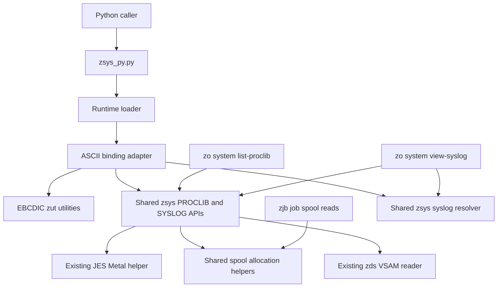

# Draft plan for zo system Python bindings

Status: approved; implementation in progress. See [implementation tasks](ZSYS_TASKS.md).

Repository baseline: `847be90dc413715b0cd6b0d84ceb028190ea2094`, reviewed on 2026-10-21. Paths below are relative to this directory unless stated otherwise.

Add `zsys_py` to the existing `zo-<version>-py3-none-any.whl` distribution. It should expose the seven general `zo system` operations through the native APIs. Keep certificate and key-ring functionality in the existing `zkr_py` module. Together, the two modules cover all 21 canonical leaf commands currently registered under `zo system`.

The recommended design follows the existing SWIG bindings: an ASCII C++ adapter, EBCDIC native implementations, explicit text conversion, Python exceptions, and the current wheel loader. The shared native `zsys.cpp` should own PROCLIB listing, SYSLOG reading, and syslog option resolution. The substantial work is preserving command semantics and making the fifth module reliable in every distribution and supported runtime.

The [review decisions](#decisions-for-the-external-review) collect the choices that affect scope and compatibility. The [implementation phases](#implementation-phases-and-dependencies) describe the proposed delivery order.

## Scope and command coverage

The command inventory comes from [`system.cpp`](../../c/commands/system.cpp) and its call to [`certificates::register_commands`](../../c/commands/certificates.cpp). This includes both nested command groups, even though their implementation lives in a separate source file.

### Seven new system functions

All proposed functions in this table belong to `zsys_py`. “Sequence” means an owning SWIG-backed sequence with iteration, indexing, and `len()`; it does not promise a built-in Python `list`. Callers can materialize a list with `list(result)`.

| Canonical CLI command | Proposed Python API | Native implementation | Result |
| --- | --- | --- | --- |
| `zo system display-symbol SYMBOL` | `display_symbol(symbol)` | `zut_substitute_symbol` | `str` |
| `zo system list-parmlib` | `list_parmlib()` | `zut_list_parmlib` | Sequence of dataset names |
| `zo system list-proclib` | `list_proclib()` | Move the current `zjb_list_proclib` implementation to `zsys_list_proclib` | Sequence of dataset names |
| `zo system list-subsystems --filter PATTERN` | `list_subsystems(filter="*")` | `zut_list_subsystems` | Sequence of subsystem names |
| `zo system list-apf` | `list_apf()` | `zut_list_apf` | Sequence of `ApfEntry` |
| `zo system list-linklist` | `list_linklist()` | `zut_list_linklist` | Sequence of `LinklistEntry` |
| `zo system view-syslog` | `view_syslog(*, date=None, time=None, seconds_ago=None, max_lines=None)` | Move `zjb_read_syslog` to `zsys_read_syslog`, with shared CLI-equivalent option resolution | `SyslogResult` |

The underlying declarations are in [`zut.hpp`](../../c/zut.hpp) and [`zjb.hpp`](../../c/zjb.hpp). There is currently no `zsys_py` binding or shared `zsys.cpp` implementation.

### Fourteen existing certificate and key-ring commands

These mappings already exist in [`zkr_py.hpp`](zkr_py.hpp). Their inclusion in the plan is a coverage and regression requirement, not a proposal to duplicate the implementations.

| Canonical command below `zo system` | Existing `zkr_py` API |
| --- | --- |
| `keyring create` | `create_keyring(owner, keyring)` |
| `keyring delete` | `delete_keyring(owner, keyring)` |
| `keyring list` | `list_certificates(owner, keyring, label, usage, max_entries)` |
| `keyring list-rings` | `list_rings(owner, keyring)` |
| `keyring count` | `count_ring(owner, keyring)` |
| `cert export` | `export_certificate`, `export_certificate_to_file`, `export_certificate_to_dsn` |
| `cert import` | `import_certificate`, `import_certificate_from_file`, `import_certificate_from_dsn` |
| `cert delete` | `delete_certificate(owner, keyring, label, database, skip_refresh)` |
| `cert show` | `show_certificate(owner, keyring, label)` |
| `cert connect` | `connect_certificate(owner, keyring, label, from_ring, from_database, usage, make_default)` |
| `cert set-default` | `set_default_certificate(owner, keyring, label)` |
| `cert trust` | `trust_certificate(owner, label, status)` |
| `cert rename` | `rename_certificate(owner, label, new_label)` |
| `cert refresh` | `refresh_digtcert()` |

Audit options as well as command names. Preserve virtual-ring behavior, exact label and usage filtering, `max_entries`, `more_available`, warnings, structured SAF/ESM/GSK errors, import/export byte handling, file/dataset variants, and refresh behavior. CLI `--label-only` and `--owner-only` map to selecting fields from certificate results. CLI aliases do not need duplicate Python functions. Database deletion uses the existing empty-keyring argument convention.

### Scope boundaries

The deliverable is a local z/OS Python library. Calls run under the Python process's identity and use the existing native services. An SSH connection is part of development and deployment, not an argument to these functions.

This increment does not add console, TSO, job-management, or other top-level `zo` command groups to `zsys_py`. It also does not add a subprocess wrapper around the `zo` executable, a new RPC transport, a replacement package name, or certificate implementations inside the new extension. Those changes would not be necessary to cover `zo system`.

## Proposed public API

### Names and result types

Use snake_case functions and PascalCase result types. Keep the import `import zsys_py` alongside the four existing imports. The wheel distribution remains `zo`; installing it does not currently imply a `from zo import system` package layout.

| Type | Public fields | Ownership |
| --- | --- | --- |
| `ApfEntry` | `dsname: str`, `volume: str` | Values copied from the native APF pair |
| `LinklistEntry` | `dsname: str`, `volume: str`, `apf: bool` | Values copied from `ZLinklstEntry` |
| `SyslogResult` | `data: str`, `start_date: str`, `start_time: str`, `end_date: str`, `end_time: str`, `returned_lines: int`, `has_more: bool` | Result owns its strings and scalar fields |

Use binding-specific C++ structs, with SWIG renames if needed, to expose these names without exporting native control blocks. Simple listing APIs return sequences directly; `len(result)` supplies the row count. A second wrapper containing `items` and `returned_rows` adds no information for these uncapped lists.

Keep native ordering and duplicates. PARMLIB and LNKLST order can matter to callers. Remove fixed-field trailing padding from dataset names, volume serials, and printable subsystem names. Preserve meaningful text, including the existing hexadecimal representation for nonprintable subsystem names. Do not strip syslog records or symbol values indiscriminately.

Suggested usage after implementation:

```python
import zsys_py as system
import zkr_py as certificates

system_name = system.display_symbol("SYSNAME")
parmlibs = list(system.list_parmlib())
jes_subsystems = list(system.list_subsystems(filter="JES*"))

for library in system.list_linklist():
    print(library.dsname, library.volume, library.apf)

result = system.view_syslog(seconds_ago=300, max_lines=250)
print(result.data, end="")
print(result.start_date, result.start_time, result.returned_lines)

# Existing certificate API remains available in the same installation.
# rings = certificates.list_rings("YOURID")
```

### Input rules

`display_symbol` accepts a bare symbol name such as `SYSNAME` or `YYMMDD`. Match the CLI's uppercase-and-prefix behavior, adding `&` in the adapter. Reject empty input, embedded NULs, unsupported characters, and input that exceeds the native 128-byte buffer after prefixing and termination. Do not add an expression-substitution API under this name. Characterize unresolved symbols and preserve the native success/error outcome rather than inventing a `KeyError` contract.

`list_subsystems` defaults to `*` and uppercases the filter before the native call. The current [`iefssi_query`](../../c/zssi.h) copies the filter into four bytes, silently truncating longer input. The proposed Python API rejects filters longer than four representable bytes, empty filters, and embedded NULs. Use the native service's matching semantics; do not promise Python regular expressions or introduce client-side wildcard matching.

For all functions, distinguish type errors from invalid values. Reject Python `bool` where an integer count is required. Validate integer bounds before narrowing to native integer types. Successful empty results remain empty sequences or an empty `SyslogResult`, not exceptions.

### Syslog option semantics

The existing CLI resolves these options before calling `zjb_read_syslog`. The proposed `zsys_read_syslog` migration must retain that resolution as a shared step; moving the reader alone would omit essential behavior from Python.

| Inputs | Effective start | Default line limit |
| --- | --- | --- |
| No date, time, or relative offset | Current z/OS time minus 30 seconds | 10,000 |
| `seconds_ago=N` | Current z/OS time minus N seconds | 10,000 |
| Both `date` and `time` | Supplied local date and time | 100 |
| Only `date` | Supplied date and current local time | 100 |
| Only `time` | Current local date and supplied time | 100 |

Enforce these rules:

- `seconds_ago` is mutually exclusive with either absolute option and must be 1–86,400 inclusive.
- `max_lines` must be 1–10,000 inclusive. `None` selects the mode-dependent default; zero does not mean unlimited.
- Accept dates in `YYYY-MM-DD`, within the CLI's year range 1900–2185, and times in `HH:MM:SS`. Reject fractional seconds and trailing text.
- Treat `None` as omission. Reject explicit empty strings and impossible calendar dates, including invalid leap days.
- Resolve one current-time snapshot on z/OS per request. Preserve local-time behavior, and test that the process timezone and the native system-offset handling agree.
- Populate `start_date` and `start_time` with the resolved values actually passed to the reader. With no returned records, return `data=""`, `returned_lines=0`, empty end fields, and the native `has_more` value.

The current CLI uses permissive `sscanf` parsing, and negative `seconds-ago` values can be treated as omission. Strict rejection of those inputs is a proposed Python contract, not a claim about current CLI behavior. Keep existing CLI behavior stable during the shared-code extraction; any CLI tightening is a separate review decision.

Two native limitations must remain explicit:

1. [`zds_read_vsam`](../../c/zds.cpp) sets `has_more` when it reaches `max_lines`, without reading ahead to prove another record exists. Expose it as a conservative limit-reached indicator.
2. The current [`zjb_read_syslog`](../../c/zjb.cpp) returns an end timestamp only to the nearest second. Preserve that contract when moving it to `zsys_read_syslog`. Reusing the timestamp can repeat records, while adding a second can skip records. Version one provides bounded reads and metadata, with no automatic pagination or exactly-once iterator.

A stronger cursor or exact `has_more` would require a separately scoped native API change. Preserve line content and newline boundaries in `data`; leave printing and formatting to the caller.

### Exceptions and diagnostics

Add `ZsysError`, derived from `RuntimeError`, for failed native operations. Follow the `ZkrError` construction pattern, but use the diagnostic fields actually available in `ZDIAG`:

- `operation` and `rc` identify the binding operation and its native return code.
- `service_name`, `detail_rc`, `service_rc`, `service_rsn`, and `service_rsn_secondary` preserve available diagnostics.
- The exception message contains converted native diagnostic text, with an operation/return-code fallback if that text is empty.

Initialize diagnostic structures and clamp fixed-buffer lengths before reading them. Some services populate only a message or a subset of fields; do not fabricate missing service codes or parse them back out of English text. Symbol substitution has no `ZDIAG` argument, so its exception uses its function name and actual return code with unavailable fields left at their documented defaults.

Use `TypeError` for wrong argument types and `ValueError` for invalid values. Preserve memory-allocation and conversion failures appropriately. Never return a successful-looking empty list after a native error, and never return partial syslog data as a complete result after a failed read.

## Native and SWIG implementation



### New adapter files

Add `zsys_py.hpp`, `zsys_py.cpp`, and `zsys_py.i`. The adapter validates inputs, converts text, calls the existing services, translates diagnostics, and copies results into Python-facing types. It does not depend on parser objects, JSON serialization, or command output streams.

The interface should use `%feature("compactdefaultargs")`, keyword support where applicable, explicit result/vector declarations, docstrings, and a module-local exception mapping. Add `SWIG_TYPE_TABLE=_zsys_py` through the existing extension loop. Retain the existing isolated type tables in the other modules.

As in `zkr_py.i`, prevent SWIG from generating a proxy class that shadows the real Python exception type, and explicitly forward the extension's `ZsysError` into the public module. Check reference ownership and attribute-assignment failures while attaching diagnostics.

Implement the four keyword-only `view_syslog` arguments through a small `%pythoncode` front end that builds an internal options value and calls one native adapter function. The C++ entry point therefore takes an options struct rather than four independent arguments, and omitted values can remain distinguishable from explicitly invalid values. Keep the public signature and defaults visible in Python help. Generated `zsys_py.py` and `zsys_py_wrap.cxx` are build products; edit the interface rather than patching generated output.

The existing `zkr_py.i` works around EBCDIC string-default literals emitted by native SWIG. Apply the same consideration to the `"*"` default and exercise both omitted and explicitly supplied keywords. An import-only check will not detect this error.

### Cross-character-mode linkage

Keep shared `native/c` translation units in EBCDIC mode and the binding adapter/SWIG wrapper in ASCII mode, as [`setup.py`](setup.py) already does. A normal C++ declaration is not sufficient across these modes: the repository documents different libc++ inline namespaces in mangled names.

`zjb_list_proclib` and `zjb_read_syslog` already sit inside the `#ifdef SWIG` C-linkage block in `zjb.hpp`. Preserve that linkage for their legacy entry points, and give the new canonical `zsys_list_proclib` and `zsys_read_syslog` entry points the same SWIG-conditional C linkage in `zsys.hpp`. The five required `zut_*` functions do not have that linkage. Add it narrowly to those five declarations, consistently visible to their definitions and callers. Do not wrap all of `zut.hpp`: it contains overloads and functions returning C++ objects by value.

Use integer return codes and output parameters across this boundary. Keep Python exception carriers and their catches on the ASCII side. Audit existing native callees for exceptions that could escape the boundary, and translate any such paths where they originate. Prove linkage with a small real z/OS call before completing the whole module.

### Move PROCLIB listing into the shared system layer

Move the C++ orchestration currently in `zjb_list_proclib` to `native/c/zsys.cpp`, with this canonical declaration in `zsys.hpp`:

```cpp
int zsys_list_proclib(ZDIAG &diag, std::vector<std::string> &proclib);
```

This operation enumerates JES PROCLIB configuration and accepts no job identifier. Its current `ZJB` argument supplies diagnostics to the Metal helper; it does not identify a job. A system API with a `ZDIAG` argument makes that responsibility explicit and follows the existing utility-listing convention.

The implementation should allocate its local `ZJB` context, call the existing `ZJBMLPRC` helper, propagate diagnostics, and assemble the dataset-name vector. Keep `ZJBMLPRC` in `zjbm.c`: it performs the JES SSI query and can remain an internal dependency of the system API. This move does not require a new Metal module or changing that helper's calling convention.

Update `handle_system_list_proclib` and the new Python adapter to call `zsys_list_proclib`. Keep `zjb_list_proclib` as a small forwarding compatibility wrapper in `zjb.cpp`, with its existing signature and linkage. Preserve native return codes, diagnostic fields, dataset order, append behavior, and fixed-field padding; Python-specific trimming belongs in the binding. There is currently no public `zjb_py.list_proclib` function to migrate.

The compatibility wrapper makes every target that links `zjb.cpp` depend on `zsys.cpp`, even if it does not itself call PROCLIB listing. Update `libzjb.a`, `libzjb.so`, the native test link, the `_zjb_py` extension, and the generated source-bundle setup accordingly. Link the shared implementation once per target. With SYSLOG also moved as described below, `_zsys_py` can use the common system/spool sources without linking the full `zjb.cpp`; the JES Metal dependency remains for PROCLIB.

Add parity tests for the new entry point and legacy wrapper, including diagnostics and prepopulated output vectors. Cover empty results, the native 100-entry capacity, and excess entries. The existing Metal loop checks capacity after copying and later overwrites its return code during storage release; include focused bounds/error-preservation corrections so the new API cannot report an overrun or truncated result as success. A C++ check after the Metal call cannot prevent a write past the buffer.

### Move SYSLOG reading into the shared system layer

The only direct in-repository caller of `zjb_read_syslog` is `handle_system_view_syslog` in `commands/system.cpp`. The current `ZJBSyslogOptions` and `ZJBSyslogResponse` types likewise appear only in that command and the native declaration/implementation. Existing system tests exercise the reader through the CLI; there is no public `zjb_py` SYSLOG API to migrate.

Move the implementation into `zsys.cpp`, with canonical system-owned types and a three-argument API in `zsys.hpp`:

```cpp
int zsys_read_syslog(ZDIAG &diag, const ZSyslogOptions &opts,
                    ZSyslogResponse &response);
```

Keep `date`, `time`, and `max_lines` in the resolved native options, and the existing data/count/end-time fields in the native response. Keep the higher-level Python `SyslogResult` and unresolved Python options separate. The system layer owns the logical SYSLOG dataset-name construction, system name and timezone lookup, VSAM positioning inputs, result timestamps, and cleanup orchestration. Update the CLI and Python adapter to call it. Move SYSLOG-specific includes and comments out of `zjb.cpp` when no remaining job code needs them.

The reader uses two static helpers that are also called by `zjb_read_job_content_by_dsn`: `zjb_read_job_dynamic_allocation` and `zjb_free_job_dynamic_allocation`. Extract their implementation once into a small internal `zspool.hpp`/`zspool.cpp`, with a `ZDIAG` argument and an allocation-options value carrying the dataset name and optional browse token. Both native callers use that helper. Keep `zds_read_vsam` and its Metal routines in the dataset layer. This avoids a reverse dependency from the system reader into job orchestration and preserves one implementation of the shared allocation protocol.

Preserve the helper's 31-bit storage layout, browse-token handling, SVC 99 text units, DD-name handling, and original-error precedence during cleanup. Retain its existing `optnone` compiler workaround during the extraction. Exercise ordinary job spool/JCL reads as well as SYSLOG because the helper has both users; do not substitute a generic allocation call without demonstrating equivalent behavior.

Follow the same compatibility policy as PROCLIB: keep `zjb_read_syslog` as a forwarding wrapper and retain its legacy struct definitions and declaration in `zjb.hpp`. Translate between legacy and canonical values explicitly. Replacing old struct names with aliases to renamed classes could change the normal C++ mangled signature, so aliases alone do not establish binary compatibility. Preserve the legacy context's encoding settings, optional allocation token, diagnostic fields, and response-buffer behavior in the translation. The public Python API continues to expose only its four documented query options; compatibility-only allocation settings remain native/internal.

The new canonical options can carry native encoding settings and internal allocation options without requiring a caller-owned `ZJB` object. The legacy wrapper forwards those values into the same read implementation. Avoid a circular include: `zsys.hpp` should not require `zjb.hpp`; PROCLIB can include `zjbtype.h` and `zjbm.h` privately in its implementation.

With this extraction, `_zsys_py` should compile `zsys.cpp`, `zspool.cpp`, `zds.cpp`, and `zut.cpp`, plus its adapter/wrapper and required Metal objects. `_zjb_py` and the native job libraries also need the shared sources for ordinary spool reads and compatibility wrappers. Verify both selective extension builds and existing native library consumers before claiming the dependency change complete.

### Shared syslog option resolution

Alongside PROCLIB listing and the SYSLOG reader, extract the parser-independent syslog option resolution from `commands/system.cpp` into `native/c/zsys.hpp` and `native/c/zsys.cpp`. The resolver's responsibility is resolving defaults, relative dates, limits, and existing native validation. The CLI retains argument parsing, presentation, and its existing error format. The Python adapter supplies its stricter argument checks, then uses the same resolution logic.

Use explicit presence information and result/options structs. Make the time calculation testable with an injected time value in the internal resolver. Supply a SWIG-conditional C-linkage entry point with output parameters, so the Python adapter can call the EBCDIC resolver. Add the new object to the native build and the Python source lists. Keep native source files C++17-compatible.

The PROCLIB move, SYSLOG reader/helper migration, and resolver extraction are distinct review decisions. If the resolver extraction is deferred, keep both operations in the shared system layer and implement resolution inside the binding first, retaining table-driven CLI parity tests. That alternative accepts duplicated normalization logic and should be recorded as a deliberate tradeoff.

### Text conversion and ownership

Treat Python text, ASCII compiler mode, ISO8859-1 bytes, and UTF-8 as distinct concepts. The existing `conversion.hpp` calls `__e2a_s`, which converts IBM-1047 to ISO8859-1, not UTF-8. A non-ASCII byte in the result is not automatically valid input to a UTF-8 Python string typemap. [IBM conversion reference](https://www.ibm.com/docs/en/zos/2.5.0?topic=functions-e2a-s-convert-string-from-ebcdic-ascii).

| Boundary | Planned handling |
| --- | --- |
| Symbol, filter, date, time inputs | Validate the supported character set, normalize, then convert once into native EBCDIC |
| Dataset names, volumes, subsystem names | Convert once on return and trim only fixed-field padding |
| Symbol values and diagnostic text | Produce valid Python Unicode, including supported non-ASCII characters |
| SYSLOG data | Convert the explicit-length IBM-1047 record buffer to UTF-8 once; preserve NULs and newline boundaries |
| Numeric codes, booleans, lengths | No character conversion |
| Existing certificate payloads | Retain `zkr_py`'s current bytes and PEM/PKCS#12 conversion contracts |

Use a length-aware conversion path for arbitrary text; the current NUL-terminated helper is insufficient for an arbitrary record buffer. Prefer a small binding-local iconv helper that produces UTF-8, with conversion failures reported, and verify its behavior on z/OS. Do not call an ordinary C++ `zut_encode` return-by-value function across character modes. Keep changes to existing modules' conversion behavior outside this feature unless a separately tested common fix is required.

The current VSAM reader appends native record bytes directly; merely forwarding an encoding option from a legacy `ZJB` or new system request does not convert that path. Establish one conversion owner and test against double conversion. The initial codepage contract follows the native IBM-1047 behavior; broader configurable SYSLOG encodings are a separate feature.

Return owned values. Test retaining a vector, an indexed entry, and a string after their originating temporaries are collected. Where SWIG exposes a borrowed entry, add an owning copy or an explicit parent reference. Do not assume that calling `list()` makes borrowed C++ elements independent. No native pointers, `ZDIAG.data`, or packed control blocks belong in the public API.

### Repeated calls and native cleanup

Python programs can keep calling these APIs within one process. Review allocation and cleanup along the native query paths, including failed calls. In particular, `zds_read_vsam` currently creates an `IO_CTRL` before `ZDSOIVSM` replaces its pointer; investigate and correct that ownership path as a focused prerequisite for repeated syslog reads.

Verify that SYSLOG dynamic allocations, VSAM resources, and subsystem/APF/LNKLST answer areas are released. Preserve the original read diagnostic if later cleanup also fails. Avoid exposing partial initialized output on allocation failure. Keep any necessary fixes narrow and cover them with targeted native regression tests.

Retain the GIL for the first version. Native thread safety has not been established by the current wrappers, and adding asynchronous execution is unnecessary for command parity. Include repeated success/failure calls and recovery after a failed call in validation.

## Build and distribution changes

### Extension and Makefile integration

Register `_zsys_py` as the fifth extension in `setup.py`. After the PROCLIB/SYSLOG migration, its expected source and native-object dependencies are:

```text
ASCII sources
  zsys_py_wrap.cxx
  zsys_py.cpp

EBCDIC sources
  ../../c/zut.cpp
  ../../c/zds.cpp
  ../../c/zsys.cpp       PROCLIB, SYSLOG, and agreed shared resolver
  ../../c/zspool.cpp     shared spool allocation and cleanup

Native objects from ../../c/build-out
  zjbm.o  zdsm.o  zutm.o  zutm31.o  zam.o  zam24.o  zutcall24.o
```

Confirm the complete link on z/OS rather than relying only on this source-derived dependency list. The new extension needs no certificate sources or GSKCMS side deck. Retain self-contained native helpers in the release extension instead of introducing a dependency on a checkout's `libzut.so`.

Add `zsys.cpp` and `zspool.cpp` to the existing `_zjb_py` source list as well, because its `zjb.cpp` will contain the forwarding compatibility wrappers and call the extracted spool helper. Verify the selective `build-zjb` target independently so an all-module build cannot conceal a missing dependency.

Add `zsys` to the default module set, selective `ZBIND_MODULES` handling, and the release check that currently requires exactly four modules. The existing loop should supply the fifth extension's isolated SWIG type table and `Py_LIMITED_API=0x030B0000`.

Extend the bindings Makefile with wrapper generation, `build-zsys`, help text, and `.PHONY` entries. Verify `make build-zsys`, `make build`, and `make wheel`. Include the shared system and spool objects in the native makefile and its relevant library, test, dependency, and SWIG rules. Existing Metal prerequisites are already present in the wheel target; only add prerequisites that the real link shows are needed.

### Release wheel contents

[`package_wheel.py`](package_wheel.py) has an explicit `MODULES` tuple, proxy-selection logic, native iteration, and a link-count check. All must include `zsys_py`. The release wheel must contain:

```text
zsys_py.py
_zsys_py.py
_zbind_native/cp311/_zsys_py.abi3.so
_zbind_native/cp313/_zsys_py.abi3.so
_zbind_native/cp314/_zsys_py.abi3.so
```

With all currently supported runtimes selected, the complete wheel contains five public proxies, five extension loader shims, the shared `_zbind_loader.py`, and 15 native extension binaries. It also retains distribution metadata, license, and correct RECORD entries. A manual build without additional `--runtime` arguments intentionally contains only `cp311`; validate contents against the explicitly selected runtime set.

The existing [`_zbind_loader.py`](_zbind_loader.py) selects a module by name and interpreter tag and appears to need no implementation change. Extend its coverage through the new module: reject unsupported platforms, unsupported interpreters, missing runtime binaries, and free-threaded interpreters using the existing error contract.

Keep the current `py3-none-any` filename and `Root-Is-Purelib: false` workaround. This is still a native z/OS distribution. The wheel builder relinks extensions for the selected Python side decks; an `abi3` suffix does not remove that dependency. Build against the existing Python 3.11 baseline and test every advertised interpreter. Python's documentation also recommends testing each supported minor version; SWIG warns that custom typemaps and nondefault optimization modes need separate Limited API scrutiny. [Python Limited API caveats](https://docs.python.org/3.11/c-api/stable.html#limited-api-caveats), [SWIG 4.3 Stable ABI guidance](https://www.swig.org/Doc4.3/Python.html#Python_stable_abi).

Do not change the runtime matrix, Python minimum, wheel tag scheme, or versioning model as part of this feature. Continue deriving the version from the root package metadata. Validate UTF-8 proxy staging, binary tagging, and checksums during packaging and transfer.

### Other distributions and staging

Update `package_precompiled.py` to include the new public proxy and package initialization. Update `package_zbind.py` in every relevant place: binding-file list, shared source list, generated flat-layout setup script, EBCDIC source classification, extension registration, and module list. Its generated wrappers remain build artifacts shipped in the source bundle so installation does not require SWIG.

Update the repository `__init__.py` exports as well. Keep the canonical top-level imports working; adding `zsys_py` must not rename existing imports or collide with certificate functions through wildcard exports.

[`scripts/buildTools.ts`](../../../scripts/buildTools.ts) already discovers binding `.cpp`, `.hpp`, and `.i` files. New shared native files are staged through its tracked-file inventory, so ensure they enter that inventory before validating the npm wheel path. A new handwritten Python helper or type stub would require a separate staging and wheel-inclusion change; the proposed `%pythoncode` wrapper avoids that extra artifact.

For this user's development builds, use the already established direct-SSH workflow and session-provided connection details. Keep personal hosts and paths out of repository configuration and this plan. Do not read Zowe configuration to obtain them. Before syncing, preserve remote sources, source the remote profile with its interactive shell replacement removed, and respect the known text-transfer conversion behavior. Convert uploaded text only once; transfer wheels and shared objects as binary.

## Files expected to change

This is the expected implementation map, subject to the review decisions below. It does not imply that each file needs a broad rewrite.

| File or area | Planned change |
| --- | --- |
| `zsys_py.hpp`, `zsys_py.cpp`, `zsys_py.i` | New adapter, public result definitions, SWIG interface, exception translation, and Python syslog front end |
| `../../c/zut.hpp` | C linkage under `SWIG` for the five system utility functions |
| `../../c/zsys.hpp`, `../../c/zsys.cpp` | Canonical PROCLIB/SYSLOG APIs, system-owned SYSLOG types, and shared syslog option resolver |
| `../../c/zspool.hpp`, `../../c/zspool.cpp` | Extracted internal spool allocation/cleanup shared by jobs and SYSLOG |
| `../../c/commands/system.cpp` | Use the shared PROCLIB/SYSLOG APIs and agreed option resolver while preserving CLI behavior |
| `../../c/makefile`, `../../c/test/makefile` | Link shared system/spool implementations into native libraries, commands, and tests |
| `../../c/zjb.cpp`, `../../c/zjb.hpp` | Retain legacy PROCLIB/SYSLOG signatures and SYSLOG structs; forward calls and use the shared spool helper for job reads |
| `../../c/zjbm.c` | PROCLIB capacity checks before copying and preservation of the original failure across storage release |
| `../../c/zds.cpp` | Focused ownership/diagnostic fixes needed for repeated syslog calls |
| `setup.py`, `Makefile` | Fifth extension, dependencies, selective build, and complete release module set |
| `package_wheel.py` | Fifth module in wheel assembly, runtime variants, and link validation |
| `package_precompiled.py`, `package_zbind.py`, `__init__.py` | Fifth module in existing bundle formats and exports |
| `test/test_zsys.py` | New API, conversion, validation, read-only integration, and parity tests |
| `test/test_swig_lifetimes.py` | All-five-module imports, iteration, temporary ownership, and error lifetime checks |
| `test/test_wheel_installation.py` | Fifth proxy/native location checks and a bounded installed-wheel system call |
| `test/run_wheel_tests.py` | Explicit suite selection, runtime smoke calls, and post-reinstall fifth-module import |
| `test/Makefile`, possibly `test/pytest.ini` | Source conversion, `test-zsys`, suite execution, JUnit merge, and declared test markers |
| `../../c/test/` | Targeted resolver/cleanup tests and CLI regressions for changed native logic |
| `../../../.github/workflows/zos-py-build.yml` | Relevant native path triggers and actual installed-wheel coverage |
| `README.md`, `../../CHANGELOG.md` | API reference, limits, five-module installation examples, and release note with the eventual issue/PR link |

The loader and TypeScript build tooling are verification targets. Change their implementation only where the new module demonstrably requires it. SDK/RPC schemas do not need new methods for this local Python binding.

## Verification strategy

### Contract and conversion tests

Use table-driven tests for real behavioral boundaries. Keep them independent of the contents of a particular LPAR wherever possible.

| Area | Required cases |
| --- | --- |
| Public surface | Seven functions, result fields, exception type, usable keyword names/defaults, correct wrong-type errors |
| Symbols | Lowercase normalization, known symbol, unresolved symbol characterization, empty/NUL/overlength input, native failure diagnostic |
| Subsystems | Omitted filter, `*`, mixed-case `JES*`, exact match, no matches, four-byte boundary, rejected overlength/NUL input, printable and hex-name results |
| Library listings | Empty and multiple results, native order and duplicates, fixed-field trimming, complete APF/LNKLST fields and booleans |
| PROCLIB migration | Canonical and legacy entry-point parity, append/padding behavior, diagnostic propagation, capacity and overflow errors, independent native/job-extension links |
| Relative syslog | Default 30 seconds, explicit bounds 1 and 86,400, rejected 0/negative/86,401, midnight/month/year rollover |
| Absolute syslog | Date-only and time-only defaults, valid leap day, invalid calendar dates, year boundaries, invalid/trailing/fractional time text |
| Option combinations | Absolute/relative conflicts, `None` versus empty/zero, integer overflow, booleans rejected, both default line limits and 1/10,000 boundaries |
| Syslog results | Empty data, bounded record counts, resolved start metadata, end metadata, native limit hint, several records sharing a timestamp |
| SYSLOG migration | Canonical/legacy reader parity, encoding/token forwarding, response reuse, timezone/date rollover, shared helper allocation/release failures, unchanged job spool/JCL reads |
| Conversion | EBCDIC punctuation, supported non-ASCII text, newlines, embedded NUL in output buffers, empty diagnostics, no double conversion |
| Errors | Native status preserved, partially populated diagnostics, no successful partial result, recovery on a subsequent call |
| Ownership | Results, vector entries, and exception attributes survive collection; repeated calls do not accumulate native resources |

Exercise pure option normalization using a controlled clock. Exercise native-error mapping through a small test seam or native fake, rather than deliberately provoking an abend or relying exclusively on a denied live call. Do not ship test-only injection functions as public API. Validate the failure path that preserves an earlier native diagnostic when cleanup also fails.

Use the existing native test framework for extracted C++ logic and ownership fixes. The implementation should follow the repository's backend-testing skill when adding those tests. Python-only tests cannot prove that the native linker, control blocks, or mixed character modes work.

### Live z/OS parity tests

Run the new read-only functions against a host where the corresponding native operations work. Compare to `zo system` with the same effective options and identity. Where available, compare structured JSON results; `display-symbol` and `list-subsystems` currently lack structured result objects, so compare their normalized text output in the test harness.

Use stable symbols for equality tests, preserve list ordering, and allow explicitly documented normalization of fixed-field spaces. For SYSLOG, use bounded absolute reads and compare record content and metadata without assuming two moving relative-time windows are identical. Account for live configuration changes and log rollover rather than weakening every assertion to “did not crash.”

Success criteria require at least one environment to execute each of the seven functions successfully. Expected permission failures can exercise diagnostics on a less-privileged environment, but they do not replace successful coverage. Do not make every native failure a skip. Distinguish unavailable facilities from regressions in reports.

Run existing `zkr_py` tests for the fourteen covered commands. Preserve their authority-sensitive skips and report them individually. Certificate/dataset lifecycle suites create resources and therefore belong in the explicitly selected functional test run with disposable fixtures; they are unnecessary for a read-only `zsys_py` smoke test.

### All-module and installed-wheel tests

Import all five modules together, vary import order in fresh subprocesses, and iterate empty/nonempty vectors from each. Retain APF/LNKLST elements after dropping their parent sequences. Run the existing certificate parent-vector and exception-reference regressions as well.

For each bundled runtime, create a fresh venv, install the produced wheel, and stage tests outside the source tree with `PYTHONPATH` removed. Verify the public proxy comes from that venv and `_zsys_py` comes from the matching `_zbind_native/cp3xx` directory. Exercise at least a real symbol read and the new result/validation paths; import success alone is insufficient.

Add the system suite explicitly to `run_wheel_tests.py`: it currently stages all `test_*.py` files but runs only selected filenames. Run pure contract tests by default. Select live read-only system tests separately, for example with an explicit `--system` option, so validating system access does not require enabling certificate/job/dataset mutations. The native module-location and post-reinstall import lists must also include `zsys_py`.

Validate wheel contents, tags, metadata, RECORD hashes, UTF-8 sources, executable native files, and runtime coverage. Exercise clean install, uninstall, and reinstall. Assert that the new extension does not depend on build-tree native libraries or the `zo` executable. Check unsupported-runtime/platform failures without changing the existing support policy.

The existing Python CI workflow builds and tests from source; it does not currently prove that the assembled release wheel works. Add installed-wheel execution to CI for available target runtimes. If the CI host lacks one of the advertised runtimes, retain a required validation result from a suitable z/OS host before release rather than silently declaring that runtime tested.

### Development and release execution

After the plan is accepted, use this sequence:

1. Record the source revision and actual remote compiler, SWIG, Python, and side-deck versions. Back up or isolate remote sources before syncing the implementation.
2. Build required native objects, then run `make build-zsys` and the focused source tests using the established direct-SSH profile setup. For source testing, select the actual extension output directory on `PYTHONPATH`; do not assume a fixed build-directory suffix on every runtime.
3. Run all binding modules together and the native regressions affected by any shared changes. The existing test Makefile's `make setup` creates the venv; add the new suite to its EBCDIC-to-UTF-8 staging rules.
4. Build the release wheel with the existing Python 3.11 build venv and explicit side decks for the other selected runtimes. Use `make wheel` and the established build requirements. Capture a binary-safe wheel and checksum.
5. Execute installed-wheel tests independently on Python 3.11, 3.13, and 3.14 for the full release artifact. Retain logs and JUnit results, including reasons for permission-based skips.
6. Smoke-test the updated precompiled and source bundles so their manifests do not lag the default five-module build.
7. Run required repository lint and build checks before calling the PR ready. If preparing complete local end-to-end artifacts, follow the repository's native rebuild, native package, then client build order. Avoid reading local connection configuration in this user's direct-SSH workflow.
8. Deliver the wheel, checksum, revision/runtime information, test results, documentation, and PR-ready changes for review. Artifact publication is a later action when requested.

The planning task itself requires no remote build, deployment, lifecycle tests, or artifact publication.

## Implementation phases and dependencies

Each phase should leave a reviewable result. Estimates below express relative effort, not elapsed-time commitments; remote build feedback and native cleanup findings determine the schedule.

| Phase | Work | Completion evidence | Relative effort |
| --- | --- | --- | --- |
| 1 | Confirm review decisions, freeze the command/API matrix, and prove utility and shared system/spool/Metal linkage in a minimal `_zsys_py` build | Successful real z/OS calls with correct text and diagnostics | Medium |
| 2 | Move PROCLIB into the shared system layer with its compatibility wrapper; implement the six non-syslog bindings, result types, input validation, and error conversion | Field-level parity, capacity/error, compatibility, link, and ownership tests | Medium |
| 3 | Move the SYSLOG reader/types into `zsys`, extract shared spool helpers, retain legacy wrappers, and implement agreed option resolution, Python adapter, text conversion, and cleanup fixes | Reader and job-spool parity, default/range/calendar tests, bounded reads, repeated-call tests, unchanged CLI behavior | Large |
| 4 | Complete fifth-module wheel, source bundle, precompiled bundle, and test-runner integration | Verified artifact manifests and compiler-free installed-wheel use | Medium |
| 5 | Validate all selected runtimes, all-five-module behavior, existing `zkr_py` coverage, CI, and documentation | Runtime matrix with successful operations, explicit skips, and ready-to-review artifact | Medium to large |

Phase 1 resolves the highest build risk before investing in the full API. Phase 3 depends on the API decisions and has the largest semantic risk. Packaging can be prepared once the module skeleton exists, but it is complete only after it includes the final implementation and passes installed-wheel testing.

Suggested changeset boundaries are native prerequisites, system bindings, distribution integration, and validation/documentation. All must be present for the feature to be considered complete; a working source-tree import alone is not the deliverable.

## Decisions for the external review

The plan can proceed using these recommendations once accepted. The alternatives are recorded here so review can resolve them without another discovery pass.

| Decision | Recommended choice | Alternative and consequence |
| --- | --- | --- |
| Module ownership | Seven new functions in `zsys_py`; fourteen existing commands stay in `zkr_py` | A single `zsys_py` namespace could add Python delegation, but needs explicit naming and import/dependency rules |
| Collection results | Owning SWIG sequences and named result records, consistent with current bindings | Built-in lists/dataclasses need a deliberate copying/facade layer and different public contracts |
| Syslog arguments | Four keyword-only options with `None` for omission; one internal C++ options struct | A public mutable `SyslogOptions` object is closer to some existing wrappers but makes simple calls more verbose |
| PROCLIB ownership | Move the C++ implementation to `zsys_list_proclib`, retain `zjb_list_proclib` as a forwarding wrapper, and keep the JES Metal helper internal | A forwarding `zsys` facade over the old implementation changes only the public grouping; removing the old native entry point would be a separate compatibility decision |
| SYSLOG ownership | Move the reader and canonical types into `zsys`, extract shared allocation/cleanup into internal `zspool`, and preserve the legacy entry point/types | Leaving helper implementations in `zjb.cpp` retains a reverse dependency; copying them creates two implementations to maintain |
| Syslog resolver refactor | Small parser-independent resolver in the same native system layer, preserving existing CLI behavior | Binding-only resolution avoids changing CLI internals but duplicates defaults and validation |
| Invalid inputs | Strict Python rejection of malformed dates, explicit negative offsets, and truncated subsystem filters | Exact reproduction of permissive CLI parsing would retain surprising behavior in a new API |
| Native cleanup | Include narrowly demonstrated ownership/diagnostic fixes needed for repeated reads | Defer fixes only if investigation shows they are not required for a reliable long-lived Python process |
| Syslog continuation | Preserve bounded reads and document the native hint/timestamp limitations | Exact continuation requires a new native cursor contract and expands this project |
| Release scope | All existing distribution formats and the current 3.11/3.13/3.14 release runtime set | A smaller runtime/artifact release must be explicitly labeled and cannot claim full existing distribution parity |

## Acceptance criteria

- Every canonical command in the 21-command inventory has a documented Python equivalent, including its meaningful options and result fields.
- The seven new functions return useful structured values, retain ordering and supported text correctly, and raise documented exceptions without printing command output.
- Native boundaries use the correct character mode and linkage. Result lifetimes and repeated syslog resource use pass targeted tests.
- The agreed Python defaults and validation rules work, and any shared CLI refactor passes existing behavior tests.
- PROCLIB listing has one canonical implementation in `zsys.cpp`; CLI, Python, and the retained native compatibility wrapper preserve the agreed results and diagnostics. Capacity handling fails safely before writing past the native buffer.
- SYSLOG has one canonical reader in `zsys.cpp`; job and SYSLOG reads share one spool allocation/cleanup implementation. Legacy native callers retain their agreed API, types, diagnostics, and allocation behavior, and ordinary job reads pass regression tests.
- The release wheel contains the fifth module for every advertised runtime and works in fresh environments outside the checkout without a compiler, SWIG, `zo` executable, or source-tree `PYTHONPATH`.
- Existing `zkr_py`, `zjb_py`, `zds_py`, and `zusf_py` remain compatible and work when imported alongside `zsys_py`.
- Native and Python test evidence distinguishes passes, failures, and environmental skips. Every new operation has successful live coverage somewhere in the release matrix.
- Source and precompiled bundle manifests, documentation, changelog, CI triggers, and installed-wheel checks include the new module. Required lint/build checks pass before the PR is marked ready.
